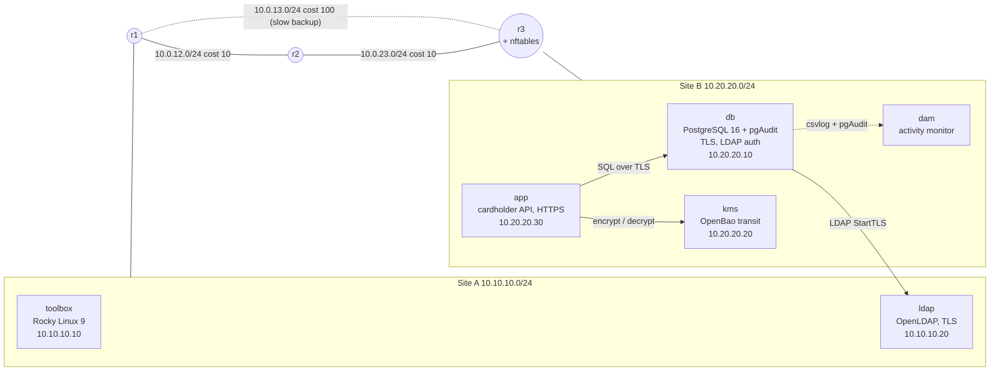

# SecureData Support Lab

A small but realistic two-site company network that runs on a laptop with one command, built to
practise the work of a **data-security product support engineer**: routing, firewalls, LDAP, TLS
and PKI, PostgreSQL with audit logging, key management (KMS), an HSM over PKCS#11, and database
activity monitoring. Faults can be injected on demand and diagnosed like real customer cases.

> Lab, not production. It follows production practices (everything as code, TLS everywhere,
> least privilege, audit logs, health checks, support bundles, CI) but the credentials, single
> unseal key and self-run CA are for learning only.

## Architecture



| Component | Software | What it demonstrates |
| --- | --- | --- |
| r1, r2, r3 | FRRouting 10 (OSPF; RIP available) | Dynamic routing, path selection by cost, failover, MTU problems |
| r3 firewall | nftables | Default-deny, allow-lists, drop counters, change-ticket mistakes |
| toolbox | Rocky Linux 9 (RHEL-compatible) | Troubleshooting from a workstation: ping, traceroute, mtr, nc, dig, tcpdump, tshark, psql, ldapsearch, openssl |
| ldap | OpenLDAP | Directory users and groups; passwords only accepted over TLS |
| db | PostgreSQL 16 + pgAudit | TLS-only access, LDAP and SCRAM authentication, pg_hba rules, audit trail |
| kms | OpenBao 2.4 (open-source Vault fork, web UI) | Encryption as a service, sealed/unsealed lifecycle, least-privilege policy, audit device |
| app | Python, HTTPS | Card numbers encrypted through the KMS; only last 4 digits + ciphertext stored |
| dam | Python (written for this lab) | Database activity monitoring: bulk exports, brute force, privilege changes |
| workbench | FastAPI + React (written for this lab) | Support console: live evidence-backed checks over the whole lab |
| HSM | SoftHSM 2 + PKCS#11 (in toolbox) | Keys generated and used inside a token, never exported (`hsm-demo`) |
| PKI | OpenSSL two-tier CA | Root, issuing CA and server certificates with proper SANs |

## Quick start (macOS with Apple chip or Intel, or Linux)

Needs Docker Desktop 4.39 or newer (Docker Engine 28+), about 4 GB of free memory and `make`.

```bash
git clone <your repo url> secure-data-support-lab && cd secure-data-support-lab
make up          # certificates, secrets, build, start, KMS init (first run takes 5-10 minutes)
make seed        # create three cardholders through the app
make status      # OSPF, path, app health, KMS, DAM
make toolbox     # shell on the Site A workstation
```

From the Mac itself: `curl --cacert certs/ca-chain.pem --resolve app.site-b.lab:8443:127.0.0.1 https://app.site-b.lab:8443/health`

Lab users (directory passwords, lab only): `alice` / `Lab-alice-2026!` (DBA), `bob` / `Lab-bob-2026!` and `carol` / `Lab-carol-2026!` (analysts).

## DataShield Support Workbench (web console)

`make up` also starts a web console at **https://localhost:9443**:

- **Overview**: a live card per component (OSPF, firewall, LDAP StartTLS, database, app, KMS seal
  state, activity monitor), each showing the exact command it ran, the output and what it means.
- **Network map**: routers, links and servers coloured from live router data; click for
  interfaces, MTU, OSPF costs, neighbours and routing tables; the current path to the database is
  animated and the banner warns when it falls back to the backup link.
- **Diagnostics**: a guided "why can't Site A reach X?" that walks name → ping → path → port → TLS
  and names the failing layer, plus individual tests (TCP timeout vs refused, TLS certificate
  checks, route lookups, OSPF interfaces, firewall counters).

Break something with `make break` and find the cause in the UI. Details, threat model and tests: [docs/workbench.md](docs/workbench.md).

## Incident scenarios

```bash
make scenarios                 # list
make break S=firewall-drop     # inject; prints the customer's ticket, not the cause
make hint  S=firewall-drop     # a nudge if you are stuck
make fix   S=firewall-drop     # restore the baseline
```

| Scenario | Area | Runbook |
| --- | --- | --- |
| ospf-mtu | Routing | [docs/runbooks/ospf-mtu.md](docs/runbooks/ospf-mtu.md) |
| core-link-down | Routing | [docs/runbooks/core-link-down.md](docs/runbooks/core-link-down.md) |
| firewall-drop | Firewall | [docs/runbooks/firewall-drop.md](docs/runbooks/firewall-drop.md) |
| cert-renewal | TLS / PKI | [docs/runbooks/cert-renewal.md](docs/runbooks/cert-renewal.md) |
| ldap-cert-untrusted | LDAP / TLS | [docs/runbooks/ldap-cert-untrusted.md](docs/runbooks/ldap-cert-untrusted.md) |
| kms-sealed | Key management | [docs/runbooks/kms-sealed.md](docs/runbooks/kms-sealed.md) |
| hba-change | Database access | [docs/runbooks/hba-change.md](docs/runbooks/hba-change.md) |
| data-exfiltration | Database security | [docs/runbooks/data-exfiltration.md](docs/runbooks/data-exfiltration.md) |
| brute-force | Authentication | [docs/runbooks/brute-force.md](docs/runbooks/brute-force.md) |

Also: [Visual tools: Docker Desktop, KMS UI, database GUI, Wireshark](docs/visual-tools.md) · [RIP vs OSPF exercise](docs/runbooks/rip-vs-ospf.md) · [HSM demo](docs/runbooks/hsm-demo.md) · [postmortem template](docs/postmortem-template.md)

## Everyday tools

```bash
make capture R=r3 F='port 5432' D=20   # packet capture on a router -> captures/*.pcap (open in Wireshark)
make bundle                            # redacted support bundle -> bundles/*.tar.gz
make alerts                            # latest database activity monitoring alerts
make test && make lint                 # unit tests and shell lint, in containers
make down / make reset                 # stop / delete everything including certificates
```

## Repository layout

```
docker-compose.yml        the whole lab: 5 networks, 9 services + the workbench
Makefile                  every operation (make help)
scripts/pki.sh            two-tier CA and certificate issuing
scripts/kms.sh            KMS init / unseal / status
scripts/scenario.sh       incident injection, hints and fixes
scripts/support-bundle.sh diagnostic bundle with secret redaction
services/router           FRR image, per-router config templates, r3 firewall
services/{toolbox,ldap,db,kms,app,dam}
workbench/                web console: backend (FastAPI) and frontend (React + TypeScript)
docs/runbooks             one runbook per incident
.github/workflows/ci.yml  lint, unit tests, and a full start-up integration test
```

## What was tested, and how

The components were tested before release, not just written: OSPF and RIP between three FRR routers
(in Linux network namespaces and in Docker), the nftables firewall, OpenLDAP with TLS, PostgreSQL 16
with pgAudit and LDAP authentication through the routed network, the DAM watcher against real
pgAudit logs (9 unit tests), the app end to end against PostgreSQL, the HSM demo on SoftHSM, and the
PKI script. The OpenBao KMS itself was replaced by an API-compatible mock in testing, and the full
`docker compose` stack is first run end to end by the CI integration job. See
[docs/testing.md](docs/testing.md).
